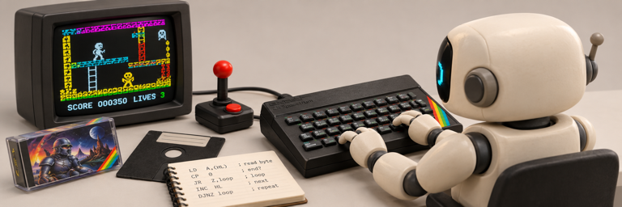

# ZX Spectrum skills

Agent skills for working with ZX Spectrum software.

## Skills

- [`zx-game-disasm`](zx-game-disasm/SKILL.md): use it when you want a whole game reverse engineered into a reference disassembly. Starting from a game image, it delivers:
  - commented Z80 source that reassembles byte for byte and still runs when relocated
  - a specification of the game's mechanics, detailed enough to reimplement the game or to train an agent to play it
  - every sprite, tile and sound rendered from the game's own data
  - a manual with bugs, pokes and maps, optionally built as a themed HTML site

  It runs unattended: one agent documents each part of the game, and another reviews the work before it is committed.
- [`zx-tape-to-trdos`](zx-tape-to-trdos/SKILL.md): use it when you have a cassette game and want it to load from disk. It analyzes the tape loader, writes a disk loader and BASIC boot, builds a disk image, and checks that the game runs from it.
- [`zx-fuse-driver`](zx-fuse-driver/SKILL.md): use it when you need to see what a program does when it runs under the [FuseX](https://github.com/speccytools/fusex) emulator. Set breakpoints and watch memory to trace how its code behaves, or press keys and read the screen to check that a change works and the program is playable. The other two skills use it to run the game they work on.

## Requirements

### All skills

- [Python](https://www.python.org) 3.11 or newer
- FuseX built from the [`automation` branch](https://github.com/morozov/fusex/tree/automation) of `morozov/fusex`: installed as `FuseX.app` on macOS; on Linux, configured with `--with-null-ui`, with `FUSEX_LIB` and `FUSEX_ROMS` pointing at its `libfusex.so` and `roms/`
- `z88dk-gdb` from a [z88dk nightly build](http://nightly.z88dk.org/)
- `timeout` from [GNU coreutils](https://www.gnu.org/software/coreutils/)

### `zx-fuse-driver`

- [numpy](https://pypi.org/project/numpy/) and [Pillow](https://pypi.org/project/pillow/), to play a game headlessly

### `zx-game-disasm`

- [SkoolKit](https://skoolkit.ca)
- [pasmo](https://pasmo.speccy.org/)
- [Vale](https://vale.sh)
- [Google Chrome](https://www.google.com/chrome/) or [Chromium](https://www.chromium.org/)
- [numpy](https://pypi.org/project/numpy/), [Pillow](https://pypi.org/project/pillow/), [fontTools](https://pypi.org/project/fonttools/) and [brotli](https://pypi.org/project/Brotli/)

### `zx-tape-to-trdos`

- [pasmo](https://pasmo.speccy.org/)
- [bas2tap](https://github.com/speccyorg/bas2tap)
- [zxspectrum-utils](https://sourceforge.net/projects/zxspectrumutils/), built from the source trunk, which has `createtrd`, `hobeta2trd` and `tzx2tap`
- [laser521](https://vtrd.in/pcutilz.php)
- [ZX0](https://github.com/einar-saukas/ZX0)
- [GNU make](https://www.gnu.org/software/make/) 4.3 or newer, [Wget](https://www.gnu.org/software/wget/) and [UnZip](https://infozip.sourceforge.net/UnZip.html)
- [trd2scl](https://worldofspectrum.net/legacy-info/spectrum-betadisk-tr-dos-disk-utilities/)
